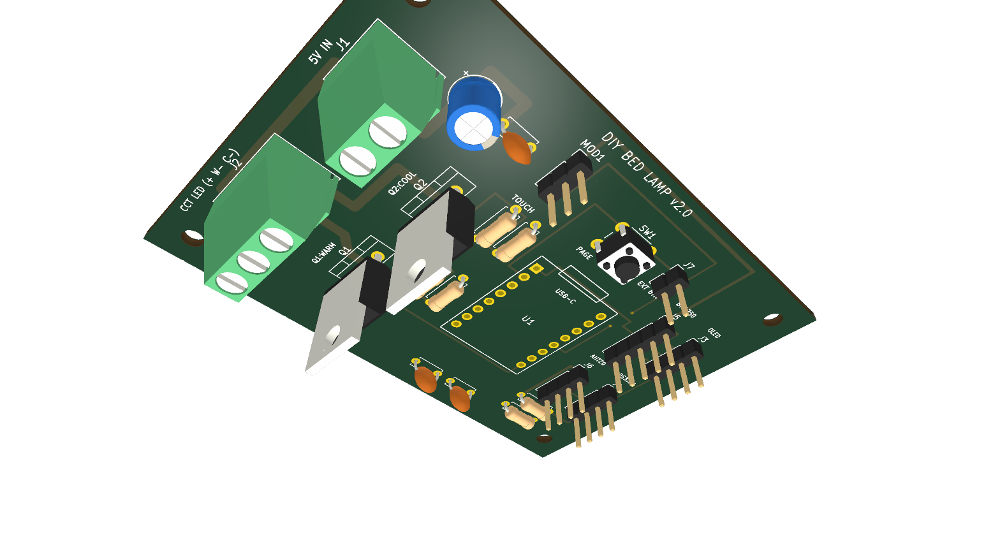
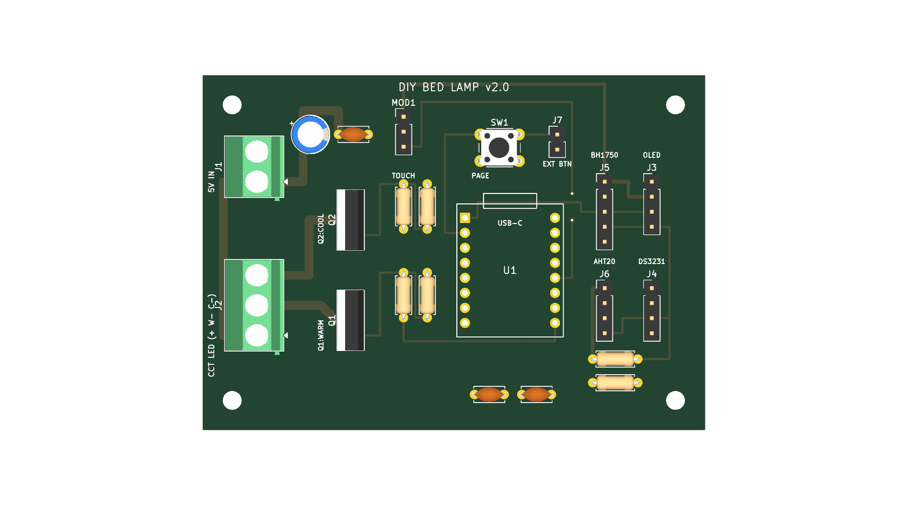

# Complete Hardware Design: USB-C Smart Reading Lamp (v2.0)

This directory contains the complete, production-ready KiCad 10 hardware design for the **USB-C Smart Reading Lamp / DIY Bed Lamp**, featuring:
- **KiCad 10 Schematic** (`smart_lamp.kicad_sch`) with **0 ERC errors / 0 warnings**.
- **Complete 2-Layer PCB Layout** (`smart_lamp.kicad_pcb`) with **0 DRC violations / 0 unconnected items**.
- **Photorealistic 3D Renders** (Top & Isometric views).
- **Production Manufacturing Package** (RS-274X Gerbers, Excellon drill files, Bill of Materials, vector PDF schematic).

---

## 1. 3D Board Previews

### Isometric 3D View

### Top View

---

## 2. Hardware Repository Files

| File / Directory | Description |
| :--- | :--- |
| [`smart_lamp.kicad_pro`](file:///c:/DRIVE%20E/MY%20CHORES/DIY%20BED%20LAMP/hardware/smart_lamp.kicad_pro) | KiCad 10 project definition file |
| [`smart_lamp.kicad_sch`](file:///c:/DRIVE%20E/MY%20CHORES/DIY%20BED%20LAMP/hardware/smart_lamp.kicad_sch) | Complete circuit schematic |
| [`smart_lamp.kicad_pcb`](file:///c:/DRIVE%20E/MY%20CHORES/DIY%20BED%20LAMP/hardware/smart_lamp.kicad_pcb) | Fully routed 2-layer PCB layout (85 mm × 60 mm) |
| [`smart_lamp.kicad_sym`](file:///c:/DRIVE%20E/MY%20CHORES/DIY%20BED%20LAMP/hardware/smart_lamp.kicad_sym) | Local project schematic symbol library |
| [`smart_lamp.pretty/`](file:///c:/DRIVE%20E/MY%20CHORES/DIY%20BED%20LAMP/hardware/smart_lamp.pretty/) | Local footprint library (`ESP32-C3-SuperMini.kicad_mod`) |
| [`fp-lib-table`](file:///c:/DRIVE%20E/MY%20CHORES/DIY%20BED%20LAMP/hardware/fp-lib-table) | Footprint library table mapping |
| [`sym-lib-table`](file:///c:/DRIVE%20E/MY%20CHORES/DIY%20BED%20LAMP/hardware/sym-lib-table) | Symbol library table mapping |
| [`gerbers/`](file:///c:/DRIVE%20E/MY%20CHORES/DIY%20BED%20LAMP/hardware/gerbers/) | Complete zip-ready Gerber & Excellon drill fabrication files |
| [`smart_lamp_bom.csv`](file:///c:/DRIVE%20E/MY%20CHORES/DIY%20BED%20LAMP/hardware/smart_lamp_bom.csv) | Full Bill of Materials |
| [`smart_lamp_erc.rpt`](file:///c:/DRIVE%20E/MY%20CHORES/DIY%20BED%20LAMP/hardware/smart_lamp_erc.rpt) | ERC verification report (**0 Errors, 0 Warnings**) |
| [`smart_lamp_drc.rpt`](file:///c:/DRIVE%20E/MY%20CHORES/DIY%20BED%20LAMP/hardware/smart_lamp_drc.rpt) | DRC verification report (**0 Violations, 0 Unconnected**) |
| [`smart_lamp_schematic.pdf`](file:///c:/DRIVE%20E/MY%20CHORES/DIY%20BED%20LAMP/hardware/smart_lamp_schematic.pdf) | High-resolution printable vector schematic PDF |

---

## 3. PCB Layout & Mechanical Specifications

| Parameter | Specification | Notes |
| :--- | :--- | :--- |
| **Dimensions** | 85.0 mm × 60.0 mm | Standard compact desk enclosure form factor |
| **Layer Count** | 2 Layers | Top (`F.Cu`), Bottom (`B.Cu`) |
| **PCB Thickness** | 1.6 mm | Standard FR-4 core |
| **Copper Weight** | 1 oz (35 µm) | Standard outer layer copper |
| **Mounting Holes** | 4× M3 (3.2 mm diameter, 6.0 mm clearance pad) | Inset 3.5 mm from each board corner |
| **Bottom Plane** | Solid GND copper plane | Uninterrupted 0V return path with thermal relief spokes |
| **Minimum Trace / Spacing**| 0.35 mm / 0.25 mm (14 mil / 10 mil) | Standard low-cost fabrication capability |
| **High-Current Traces** | 1.50 mm (60 mil) | +5V Rail, `/LED_WARM_NEG`, `/LED_COOL_NEG` (>3A continuous capability) |
| **Power Distribution Traces** | 0.80 mm / 0.60 mm | 5V MCU feed (0.8mm), +3.3V Sensor/OLED rail (0.6mm) |
| **Signal Traces** | 0.35 mm (14 mil) | PWM outputs, I2C bus (SDA/SCL), Touch in, Page button |

---

## 4. Subsystems & Pinout Mapping

### 4.1 Microcontroller (ESP32-C3 SuperMini)
- **Pin 9 (`5V`)**: 5V DC input filtered by `C1` (100 µF) and `C2` (100 nF).
- **Pin 10 (`GND`)**: Direct tie to solid ground plane.
- **Pin 11 (`3V3`)**: 3.3V regulated output filtered by `C3` (10 µF) and `C4` (100 nF) distributing power to all sensors and OLED.
- **Pin 16 (`GPIO0` / Net `/PWM_WARM`)**: 20 kHz PWM output driving warm white LED MOSFET `Q1`.
- **Pin 15 (`GPIO1` / Net `/PWM_COOL`)**: 20 kHz PWM output driving cool white LED MOSFET `Q2`.
- **Pin 13 (`GPIO3` / Net `/TOUCH_IN`)**: Active-HIGH momentary capacitive touch input from TTP223 module.
- **Pin 12 (`GPIO4` / Net `/I2C_SDA`)**: Hardware I2C data bus with 4.7 kΩ pullup `R5`.
- **Pin 1 (`GPIO5` / Net `/I2C_SCL`)**: Hardware I2C clock bus with 4.7 kΩ pullup `R6`.
- **Pin 2 (`GPIO6` / Net `/BTN_PAGE`)**: Page button input with internal pullup; triggered by onboard tact switch `SW1` or external terminal `J7`.
- **Strapping Pins (`GPIO8`, `GPIO9`)**: Isolated with no-connect markers per `PLAN.md` to prevent bootloader conflicts.

### 4.2 Dual MOSFET Low-Side LED Driver
- **Warm White Channel**:
  - `R1`: 100 Ω damping resistor in series between GPIO0 and `Q1` Gate.
  - `R2`: 10 kΩ pulldown resistor from Gate to GND (ensures MOSFET stays fully off during MCU reset/boot).
  - `Q1`: IRLZ44N logic-level N-channel MOSFET in TO-220 package (Vgs(th) 1.0–2.0V, Rds(on) 22 mΩ at 3.3V).
- **Cool White Channel**:
  - `R3`: 100 Ω damping resistor in series between GPIO1 and `Q2` Gate.
  - `R4`: 10 kΩ pulldown resistor from Gate to GND.
  - `Q2`: IRLZ44N logic-level N-channel MOSFET in TO-220 package.
- **Heat Dissipation**: Both MOSFETs are positioned along the left-center board area with standard TO-220 vertical footprints, accommodating bolt-on clip heatsinks if driving high-power strips (>3A).

### 4.3 Connectors & Peripheral Pinout

| Reference | Component / Function | Footprint | Pinout |
| :--- | :--- | :--- | :--- |
| **J1** | 5V Power Input | TerminalBlock MKDS-1,5 2-Pin | **1:** +5V, **2:** GND |
| **J2** | CCT LED Strip Output | TerminalBlock MKDS-1,5 3-Pin | **1:** +5V (Common Anode), **2:** W- (Warm Cathode), **3:** C- (Cool Cathode) |
| **J3** | SSD1306 0.96" OLED | PinHeader 1x04 (P=2.54mm) | **1:** GND, **2:** +3.3V, **3:** SCL (GPIO5), **4:** SDA (GPIO4) |
| **J4** | DS3231 RTC Module | PinHeader 1x06 (P=2.54mm) | **1:** 32K, **2:** SQW, **3:** SCL, **4:** SDA, **5:** VCC (+3.3V), **6:** GND |
| **J5** | BH1750 Ambient Light Sensor | PinHeader 1x05 (P=2.54mm) | **1:** VCC (+3.3V), **2:** GND, **3:** SCL, **4:** SDA, **5:** ADDR (Tied to GND) |
| **J6** | AHT20 Temperature/Humidity | PinHeader 1x04 (P=2.54mm) | **1:** VIN (+3.3V), **2:** GND, **3:** SCL, **4:** SDA |
| **J7** | External Page Button | PinHeader 1x02 (P=2.54mm) | **1:** BTN_PAGE (GPIO6), **2:** GND |
| **SW1** | Onboard Page Button | Tactile Switch 6x6mm (H=5mm) | **1,2:** BTN_PAGE (GPIO6), **3,4:** GND |
| **MOD1** | TTP223 Touch Module | PinHeader 1x03 (P=2.54mm) | **1:** VCC (+3.3V), **2:** GND, **3:** OUT (GPIO3) |

---

## 5. Bill of Materials (BOM)

| Ref | Value | Package / Footprint | Description | Qty |
| :--- | :--- | :--- | :--- | :---: |
| **U1** | ESP32-C3-SuperMini | PinHeader_2x08_P2.54mm | ESP32-C3 SuperMini MCU module | 1 |
| **Q1, Q2** | IRLZ44N | TO-220-3_Vertical | Logic-Level N-MOSFET (55V, 47A, Vgs(th) 1-2V) | 2 |
| **MOD1** | TTP223_Touch | PinHeader_1x03_P2.54mm | TTP223 capacitive touch sensor module | 1 |
| **SW1** | SW_PUSH_6mm | Button_Switch_THT:SW_PUSH_6mm_H5mm | Onboard momentary page tact switch | 1 |
| **R1, R3** | 100 Ω | Resistor_THT:R_Axial_DIN0207_P7.62mm | 1/4W 5% Metal film gate damping resistor | 2 |
| **R2, R4** | 10 kΩ | Resistor_THT:R_Axial_DIN0207_P7.62mm | 1/4W 5% Metal film gate pulldown resistor | 2 |
| **R5, R6** | 4.7 kΩ | Resistor_THT:R_Axial_DIN0207_P7.62mm | 1/4W 5% Metal film I2C pullup resistor | 2 |
| **C1** | 100 µF 16V | Capacitor_THT:CP_Radial_D6.3mm_P2.50mm | Low-ESR electrolytic bulk filter capacitor | 1 |
| **C2, C4** | 100 nF | Capacitor_THT:C_Disc_D5.0mm_W2.5mm_P5.00mm | Ceramic decoupling capacitor (50V) | 2 |
| **C3** | 10 µF | Capacitor_THT:C_Disc_D5.0mm_W2.5mm_P5.00mm | Ceramic bulk capacitor (16V) | 1 |
| **J1** | 5V_IN | TerminalBlock_Phoenix:MKDS-1,5-2 | 5.08mm 2-pin screw terminal | 1 |
| **J2** | CCT_LED | TerminalBlock_Phoenix:MKDS-1,5-3 | 5.08mm 3-pin screw terminal | 1 |
| **J3, J6** | Conn_01x04 | Connector_PinHeader_2.54mm:PinHeader_1x04_P2.54mm | 4-pin female header (OLED & AHT20) | 2 |
| **J4** | Conn_01x06 | Connector_PinHeader_2.54mm:PinHeader_1x06_P2.54mm | 6-pin female header (DS3231 RTC) | 1 |
| **J5** | Conn_01x05 | Connector_PinHeader_2.54mm:PinHeader_1x05_P2.54mm | 5-pin female header (BH1750 Sensor) | 1 |
| **J7** | Conn_01x02 | Connector_PinHeader_2.54mm:PinHeader_1x02_P2.54mm | 2-pin male header (Ext Page Button) | 1 |
| **H1..H4** | MountingHole_3.2mm_M3 | MountingHole:MountingHole_3.2mm_M3_Pad | M3 mounting holes with 6mm isolation pad | 4 |

---

## 6. Manufacturing & Fabrication Guide

All production files in [`hardware/gerbers/`](file:///c:/DRIVE%20E/MY%20CHORES/DIY%20BED%20LAMP/hardware/gerbers/) adhere to standard RS-274X Gerber and Excellon drill specifications.

### Recommended Fabrication Settings (JLCPCB / PCBWay / Aisler):
- **Base Material**: FR-4 Standard (Tg 130-140°C)
- **Layer Count**: 2 Layers
- **Dimensions**: 85.0 mm × 60.0 mm
- **PCB Thickness**: 1.6 mm
- **Copper Weight**: 1 oz (35 µm)
- **Surface Finish**: HASL with lead (economical) or Lead-Free HASL / ENIG
- **Solder Mask Color**: Matte Black, Blue, or Classic Green
- **Silkscreen Color**: White
- **Minimum Via Diameter / Drill**: 0.8 mm / 0.4 mm

### Gerber Layer Mapping:
- `smart_lamp-F_Cu.gtl` - Top Copper Layer
- `smart_lamp-B_Cu.gbl` - Bottom Copper Layer (GND Plane)
- `smart_lamp-F_Mask.gts` - Top Solder Mask
- `smart_lamp-B_Mask.gbs` - Bottom Solder Mask
- `smart_lamp-F_Silkscreen.gto` - Top Silkscreen Legend
- `smart_lamp-B_Silkscreen.gbo` - Bottom Silkscreen Legend
- `smart_lamp-Edge_Cuts.gm1` - Board Contour & Cutouts (85 mm × 60 mm)
- `smart_lamp.drl` - Excellon Drill File (Plated & Non-Plated Holes)
- `smart_lamp-job.gbrjob` - KiCad Gerber Job Information

---

## 7. Verification Reports Summary

- **ERC Report**: [smart_lamp_erc.rpt](file:///c:/DRIVE%20E/MY%20CHORES/DIY%20BED%20LAMP/hardware/smart_lamp_erc.rpt)
  - **Status**: PASSED (`0 Errors, 0 Warnings`)
- **DRC Report**: [smart_lamp_drc.rpt](file:///c:/DRIVE%20E/MY%20CHORES/DIY%20BED%20LAMP/hardware/smart_lamp_drc.rpt)
  - **Status**: PASSED (`0 DRC Violations, 0 Unconnected Items`)
